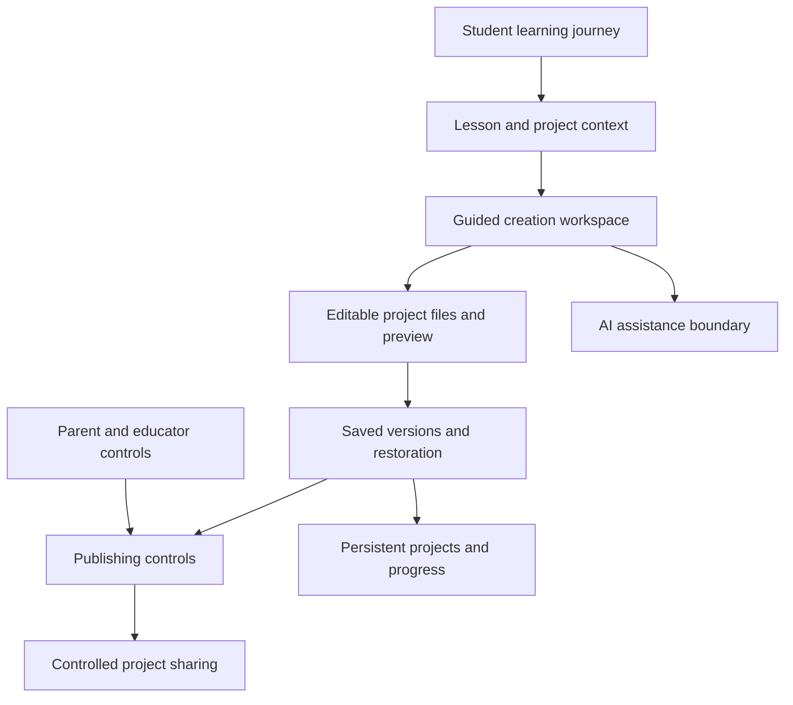

# CuriousGo — AI-Guided Learning & Project Creation

CuriousGo is an AI-guided creation and learning platform where kids build games and interactive projects through structured workflows, editable workspaces, and age-appropriate controls.

## Product

CuriousGo combines student learning activities with project workspaces, parent and educator surfaces, and studio operations. Students work within a guided environment that emphasizes AI literacy, safety, and verification while retaining an editable project environment.

## Problem

A blank chat prompt leaves students to define the task, judge the result, and manage a technical environment at once. A learning product needs scaffolding, age-appropriate interaction, reversible work, and clear boundaries between private creation and sharing.

## What I Built

I designed and built guided student workspaces, lesson-context loading, an editable Monaco environment, project persistence and version workflows, publishing controls, and supporting family/studio infrastructure. The system includes student, parent, educator, and administrative surfaces alongside authentication, curriculum, progress, and payment integration paths.

## What This Demonstrates

Learning-product architecture · guided creation UX · editable project environments · versioned persistence · role-aware workflows · family controls · integration of content, creation, and verification.

## Architecture

This diagram shows product and service boundaries, not infrastructure topology or database structure.

## Technical Stack

Next.js · React · TypeScript · Monaco Editor · Tailwind CSS · Supabase/Postgres · NextAuth · OpenAI integration utilities · Zod · Stripe · Vercel Analytics · Web Push · Vercel deployment configuration.

## Engineering Decisions

### 1. Guide creation with lesson context

The workspace loads educational context alongside the project. The interaction starts from a learning goal and bounded project task, rather than requiring students to invent a complete prompt and environment.

### 2. Keep projects editable

Monaco provides a real file-editing surface alongside assistance and preview. Students can inspect and revise the artifact instead of accepting an opaque generated result.

### 3. Make versions a learning and reliability tool

Saved versions and restoration provide checkpoints around edits and sharing. Persistent project services connect that workflow to student-owned work.

### 4. Build publishing into the control model

Publishing is a product workflow governed by user roles and family controls. Project creation and public sharing are separate decisions rather than a single automatic deployment step.

### 5. Keep the AI-edit boundary explicit

The current workspace uses deterministic assistance to exercise guided-edit interactions; live OpenAI utilities exist elsewhere in the application. Connecting model-driven edits to this workspace is a planned capability, not a claim of current autonomous project generation.

## Production Considerations

The application includes role-aware authentication, request validation, project ownership checks, parent export controls, signed payment-webhook handling, file-validation utilities, and rate-limiting code. Deployment configuration and an operations runbook address environment/runtime behavior. The repository has lint/build scripts; a comprehensive automated workspace test suite was not established by this audit.

## Current Implementation and Direction

Implemented editor, lesson, version, persistence, and control workflows demonstrate the guided-creation architecture. Model-driven project editing is an architectural direction. This case study does not claim that a live model currently generates and hosts arbitrary student applications.

<!-- Add sanitized product screenshot here -->

## Source Policy

CuriousGo’s application source and commercial IP remain private. The material here was written for public architectural review and includes no student or family data, credentials, private prompts, production schemas, or sensitive implementation details.
